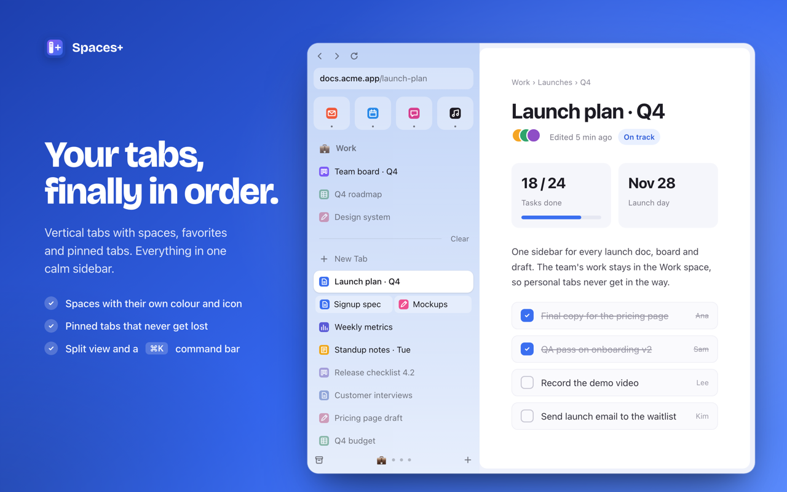
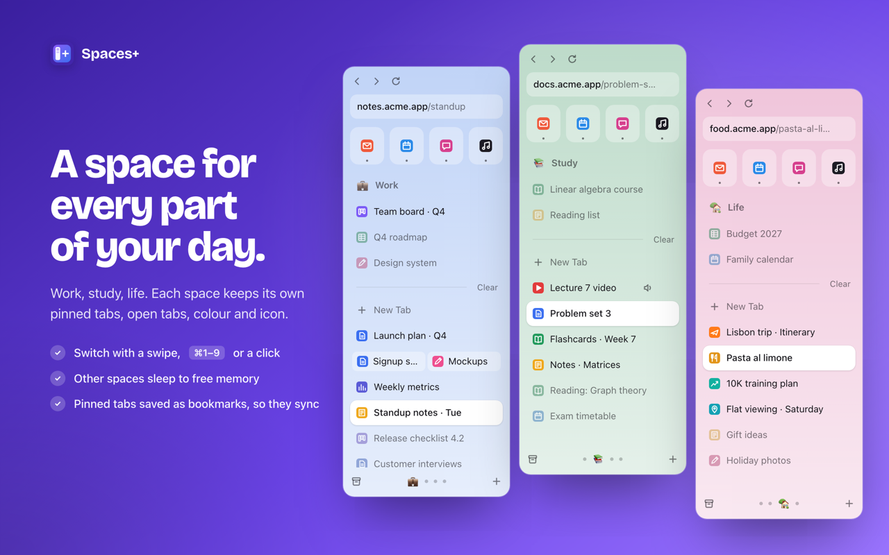
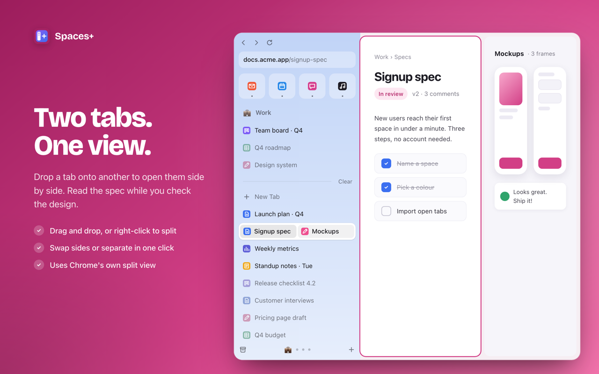
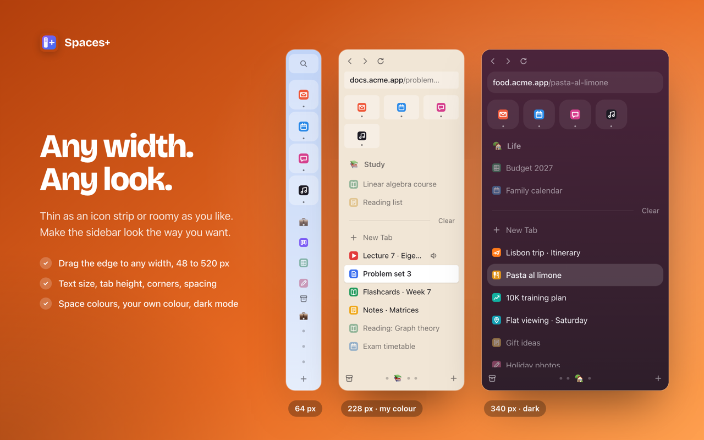
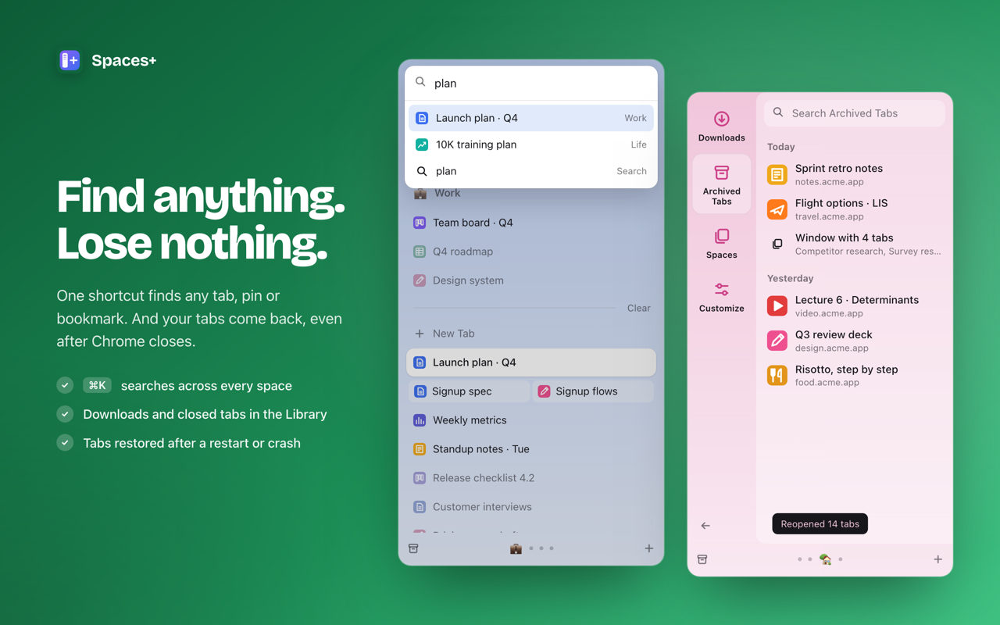

<div align="center">


# Spaces Plus

**Arc-style vertical tabs for Chrome, Brave and Edge.**
Spaces, pinned tabs, favorites and split view, in a sidebar as narrow or wide as you like.
No account, no server, no tracking.

[**Install from the Chrome Web Store**](https://chromewebstore.google.com/detail/kabkpkdiclbphidmcpjffbenncpkjclk) · [Load from source](#install-from-source) · [Coming from Arc?](#coming-from-arc)



</div>

---

## Why

Arc isn't getting new features anymore, and its sidebar is the part people miss most. Spaces Plus brings that sidebar to Chromium browsers. It doesn't use its own backend: it builds on tab groups, bookmarks and side panels, which the browser already has.

## Features

| | |
|---|---|
| 🗂 **Spaces** | Group tabs into spaces such as Work, Study and Life. Each space can have any colour and an emoji icon. Drag spaces to reorder them. |
| 📌 **Pinned tabs** | Each space keeps its own pinned tabs. They're saved as bookmarks, so they survive restarts and reinstalls, and they sync if you sync bookmarks. |
| ⭐ **Favorites** | A row of big icons at the top that stays the same in every space. |
| 🪟 **Split view** | Drop one tab onto another to show them side by side (Chrome 155+). |
| ⌘ **Command bar** | `Cmd/Ctrl+K` or `/` searches every tab, pinned tab, favorite and bookmark. |
| 💤 **Tab sleep** | Tabs in other spaces go to sleep and free their memory. Tabs playing audio are never put to sleep. |
| 📐 **Any width** | Shrink it to a 48px strip of icons or widen it to a full sidebar. Use it as a floating window or a side panel. |
| 🎨 **Your look** | Colours, sizes, rounded corners, light, dark and automatic themes. |
| 📚 **Library** | Downloads grouped by day, plus recently closed tabs. |
| 🔁 **Move browsers** | Export everything to one file and import it in another browser. |

### Shortcuts

| Action | Keys |
|---|---|
| Open the sidebar | `Alt+S` |
| Next / previous space | `Alt+Shift+→` / `Alt+Shift+←` |
| Jump to space 1–9 | `Cmd/Ctrl+1` … `9` (while the sidebar is focused) |
| Command bar | `Cmd/Ctrl+K` or `/` |

## Screenshots

| Spaces | Split view |
|---|---|
|  |  |
| **Any width** | **Find anything** |
|  |  |

## Install

### From the Chrome Web Store

[**Spaces Plus on the Chrome Web Store**](https://chromewebstore.google.com/detail/kabkpkdiclbphidmcpjffbenncpkjclk). The same link works in Brave and Edge.

### Install from source

```bash
git clone https://github.com/Tanvir-rahman/spaces-plus.git
```

1. Open `chrome://extensions` (or `brave://extensions`).
2. Turn on **Developer mode**.
3. Click **Load unpacked** and choose the `extension` folder.

There's no build step. It's plain JavaScript, HTML and CSS.

## Coming from Arc?

1. Press `Alt+S` and create one space for each of your Arc spaces.
2. Right-click a tab and choose **Pin to "space"** to rebuild your pinned section.
3. Right-click a tab and choose **Add to Favorites** for your top sites.
4. Already using Chrome tab groups? Each group becomes a space automatically.

**Want no tab bar at all, like Arc?** Use Brave:

1. Open `brave://settings/appearance` and turn on **vertical tabs** and **hide completely when collapsed**.
2. Collapse the tab column.
3. In Spaces Plus **Customize**, set the mode to **Side panel**.

Chrome doesn't let extensions hide its tab bar ([research notes](docs/reports/Hiding%20Chrome%20tab%20strip.md)).

## How it works

A **space is a tab group plus a bookmark folder**. The extension keeps no copy of your tabs, so it can't drift out of sync with the browser.

```
Space "Work"
├── open tabs    →  Chrome tab group named "Work"
└── pinned tabs  →  Bookmarks › Other bookmarks › Spaces Plus › Work
Favorites        →  Bookmarks › Other bookmarks › Spaces Plus › ★ Favorites
Settings, order  →  chrome.storage.local
```

| File | What it does |
|---|---|
| [`extension/core.js`](extension/core.js) | Space logic shared by every part of the extension: create, rename, recolour, switch, sync with tab groups, import and export |
| [`extension/background.js`](extension/background.js) | Service worker: shortcuts, the floating window that follows the browser window, restoring tabs after a restart |
| [`extension/panel.js`](extension/panel.js) | The sidebar UI: drag and drop, split view, command bar, library |
| [`extension/customize.js`](extension/customize.js) | Settings page: look, behaviour, export and import |

More detail, including the bugs that took longest, is in the [build write-up](store/DEVTO.md).

## Privacy

- No servers, analytics, account or remote code.
- The extension makes no network requests of its own.
- Data stays in the browser's extension storage and your own bookmarks.
- Uninstalling the extension removes its data.

Full policy: [appmotives.com/spaces-plus/privacypolicy](https://appmotives.com/spaces-plus/privacypolicy/)

<details>
<summary>Why each permission is needed</summary>

| Permission | Used for |
|---|---|
| `tabs`, `tabGroups` | Showing tabs and keeping each space's tab group in sync |
| `bookmarks` | Storing pinned tabs and favorites, and command bar search |
| `storage` | Saving spaces and settings |
| `sidePanel` | Side panel mode |
| `system.display` | Placing the floating sidebar next to the browser window |
| `search` | Running a web search from the command bar with your default engine |
| `sessions` | Recently closed tabs in the Library |
| `downloads`, `downloads.open` | The Downloads list in the Library |
| `favicon` | Site icons |

</details>

## Repo layout

```
extension/   the extension (load this folder unpacked)
store/       Chrome Web Store listing, screenshots, promo video, build write-up
docs/        research notes (hiding Chrome's tab bar)
tools/       dev check scripts and a one-off Arc → Chrome tab importer
```

## Contributing

Issues and pull requests are welcome. If something feels less like Arc than it should, [open an issue](https://github.com/Tanvir-rahman/spaces-plus/issues). That list is the roadmap.

If Spaces Plus saves you from tab chaos, a ⭐ helps other people find it.

---

<div align="center">
Made by <a href="https://appmotives.com/">AppMotives</a> · <a href="mailto:support@appmotives.com">support@appmotives.com</a><br>
<sub>Not affiliated with The Browser Company. Arc is their trademark.</sub>
</div>
